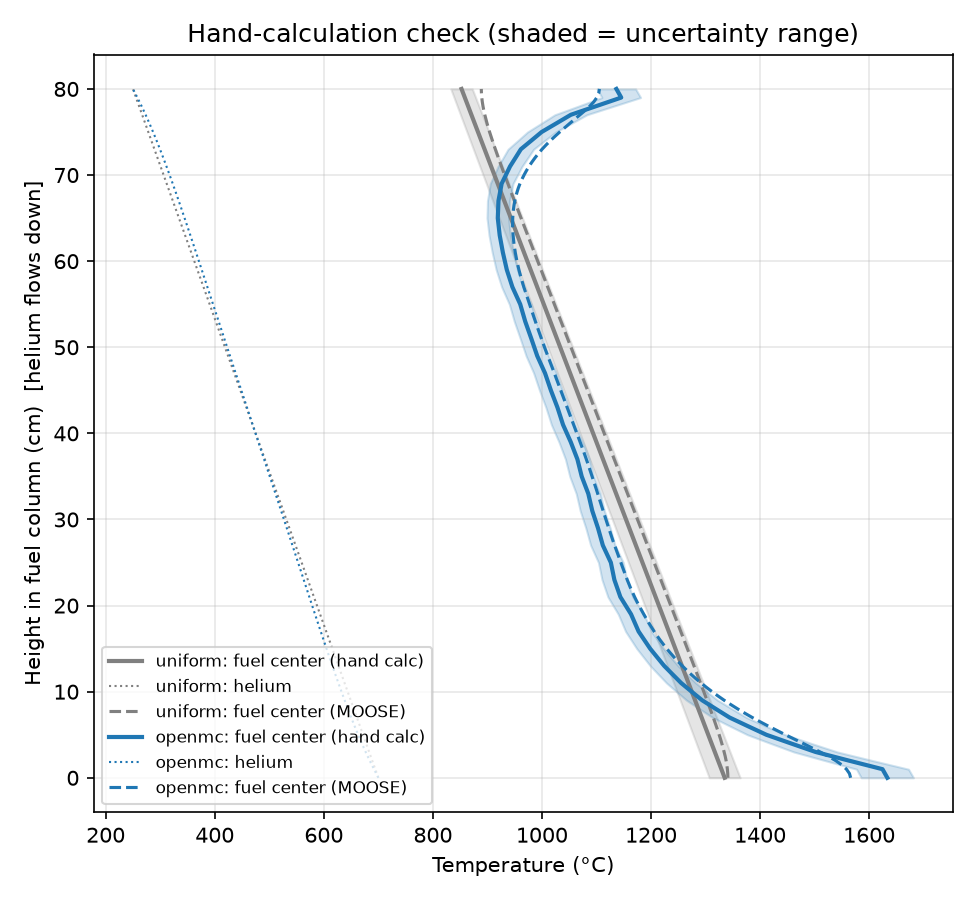
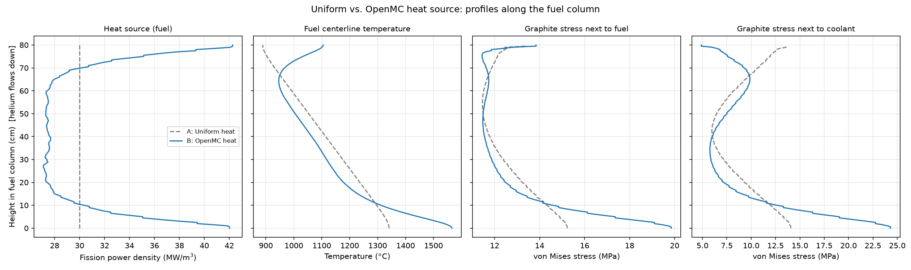
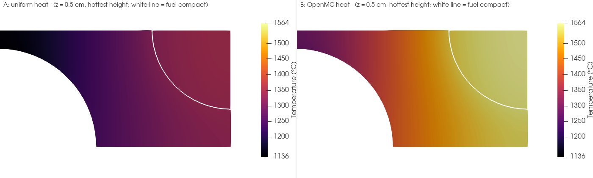
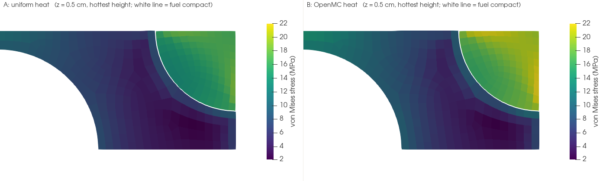
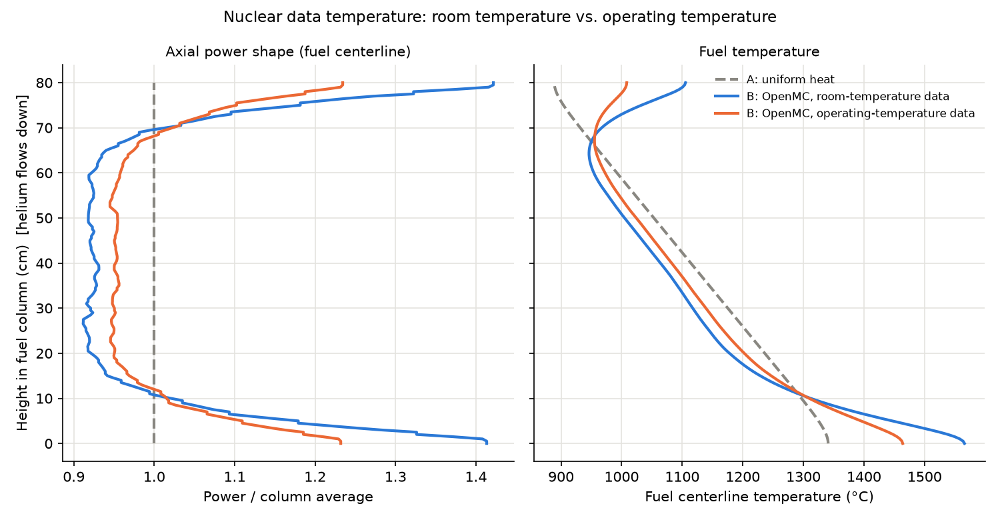
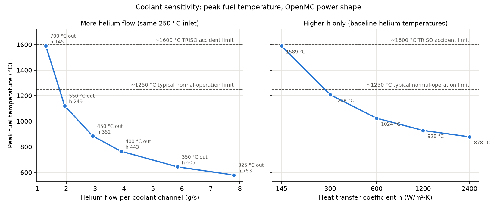

# Coupled OpenMC–MOOSE Multiphysics Simulation of HTGR Microreactor RVE
## Status: Active Development — Phase 4 (results written up below; input assumptions under review)

A 2-step coupled neutronics and thermo-mechanical finite element simulation of a transportable High-Temperature Gas-Cooled Reactor (HTGR) microreactor core unit cell based on Project Pele. The workflow couples Monte Carlo neutron transport (**OpenMC**) with continuum thermal-stress analysis (**MOOSE Framework**).

## Technical Overview

This repository models the coupled reactor physics, spatial heat generation, temperature distribution, and von Mises stress state in a TRISO fuel compact / H-451 graphite matrix Representative Volume Element (RVE). 

**Problem statement:** How much does a simplified physics assumption change the answer, and what does extra fidelity cost? The same MOOSE thermal-stress model is run twice with the *same total power*:

| Case | Heat source in the fuel compact | Input |
|---|---|---|
| **A — Simplified** | Uniform volumetric heating $Q = Q_{avg}$ | `moose/case_uniform.i` |
| **B — Higher fidelity** | Spatially varying $Q(x,y,z)$ from an OpenMC neutron transport solve | `moose/case_openmc.i` |

The cases are compared on peak temperature, peak von Mises stress, and compute time (including the OpenMC run needed for Case B).

* **Physics Modules:** Monte Carlo Neutron Transport, `HeatConduction`, `TensorMechanics`
* **Software Stack:** OpenMC, MOOSE Framework, Coreform Cubit, Python (`h5py`, `scipy`), ParaView
* **Target Materials:** HALEU TRISO compacts (19.75% U-235), H-451 Nuclear Graphite, Helium Coolant
* **Coupling Paradigm:** Off-line 2-step data transfer (Neutronics Mesh Tally $\rightarrow$ Spatial Heat Source Kernel)

## 4-Phase Development Workflow

### Phase 1: OpenMC Neutronics & Power Tallying [*COMPLETE*]
* Define isotopic compositions for HALEU TRISO compacts, H-451 graphite matrix, and helium channels.
* Build a Constructive Solid Geometry (CSG) model of the $18.80\text{ mm} \times 9.40\text{ mm}$ quarter-cell RVE in OpenMC, matching the CAD cross-section exactly (quarter coolant hole $r = 7.94$ mm at the origin corner, quarter fuel compact $r = 6.35$ mm at the opposite corner).
* Model a **full-height 80 cm fuel column** with 40 cm graphite reflectors above and below (vacuum at the top and bottom, reflective on the sides), so the axial power shape is physically meaningful.
* Model the fuel compact as homogenized TRISO particles (35% packing fraction) in a graphite binder.
* Execute Monte Carlo eigenvalue solve ($k_{\text{eff}}$) with a cylindrical mesh tally on the fuel compact to extract the fission power shape.

### Phase 2: CAD Geometry & Coreform Cubit Meshing [*COMPLETE*]
* Model the 3D unit cell in SolidWorks and export to `.STEP` format.
* Model the 3D unit cell at the full 800 mm fuel-column height (corner at the origin, z from 0 to 800 mm).
* Execute automated Coreform Cubit journal script (`create_mesh.jou`) to generate a swept HEX8 mesh (~40,000 elements, under the 50,000-element Coreform Cubit Learn limit) with two blocks: `matrix_graphite` and `fuel_compact`.
* Define explicit surface sidesets (`symm_x_min`, `symm_y_min`, `bottom_face`, `fuel_wall`, `coolant_wall`) and scaling to SI units.

### Phase 3: Data Coupling & MOOSE Multiphysics Solve [*COMPLETE*]
* Run Python bridge script (`coupling/map_power.py`) to parse OpenMC `statepoint.*.h5` tally outputs, normalize to the target average power density, and write a 3D x-y-z grid for MOOSE.
* Shared MOOSE base input (`moose/pele_core_sim.i`) plus two case files that only swap the heat source: `ConstantFunction` (Case A) or `PiecewiseMultilinear` driven by OpenMC (Case B).
* Helium coolant temperature varies with height from a channel energy balance (downward flow, 250 °C inlet → 700 °C outlet). Each case uses its own power shape for the heat-up, so the uniform case gets a linear profile and the OpenMC case an S-shaped one.
* The wall heat transfer coefficient ($h \approx 150\text{ W/m}^2\text{K}$) is made consistent with the helium flow implied by that energy balance (Reynolds number ~2,800, barely turbulent), rather than assumed.
* Enforce planar symmetry roller constraints and solve coupled non-linear heat conduction and isotropic linear elasticity.
* Built-in energy balance check (`power_in` vs `power_out` postprocessors) and run-time reporting.

### Phase 4: Comparative Stress Analysis & Documentation [*IN PROGRESS*] — see [Results](#results-phase-4)
* Compare thermal gradients and von Mises stress fields between realistic neutronics power profiles vs. uniform volumetric heat assumptions. *(done)*
* Compare cost: OpenMC + mapping + MOOSE wall time (Case B) vs. MOOSE alone (Case A). *(done)*
* Automated by `post-processing/compare_cases.py` using line samplers along the column (fuel centerline, graphite next to the fuel wall, graphite next to the coolant wall). *(done)*
* Process Exodus II results in ParaView to identify peak stress concentrations along the fuel-graphite interface. *(done: `post-processing/render_fields.py`)*
* Document structural safety margins and local peaking factors for microreactor core licensing considerations. *(done for the current inputs; input assumptions still under review)*
* Sensitivity checks: helium flow and $h$, nuclear-data temperature, mesh resolution. *(done)*

## Verification & Quality Assurance (QA)

To ensure numerical stability, physical conservation, and accurate multivariable coupling between OpenMC and MOOSE, this workflow executes specific verification checks across five areas:

### 1. Spatial Geometry & Mesh Quality Checks (SolidWorks & Coreform Cubit)
* **Domain Bounding:** Verified unit cell dimensions ($18.80\text{ mm} \times 9.40\text{ mm}$) against Project Pele RVE design specs to prevent volume overlaps.
* **Element Metrics:** Inspected the HEX8 mesh in Coreform Cubit to enforce minimum scaled Jacobian values $> 0.6$. In-plane elements (0.6 mm) resolve the fuel-matrix and coolant-wall gradients; elements are deliberately elongated along $z$ (6.4 mm layers) because axial gradients are gentle, keeping the mesh under the 50,000-element license limit.
* **Unit Consistency:** Automated scale transformations in `create_mesh.jou` to convert CAD dimensions ($\text{mm}$) to SI units ($\text{m}$) required by MOOSE.
* **Sideset Integrity:** Validated explicit surface sideset IDs (`symm_x_min`, `symm_y_min`, `bottom_face`, `fuel_wall`, `coolant_wall`) against Exodus block exports to prevent unconstrained degrees of freedom.

### 2. Neutronics & Cross-Section Verification (OpenMC)
* **Isotopic Composition:** Verified HALEU enrichment ($19.75\text{\% } ^{235}\text{U}$) and H-451 graphite composition against nominal HTGR material specifications.
* **Eigenvalue Convergence:** Shannon entropy and per-batch $k$ are plotted by `neutronics/check_convergence.py` (`images/source_convergence.png`) to confirm the fission source has settled before the active batches begin.
* **Spatial Alignment:** OpenMC geometry uses the same corner origin and dimensions as the CAD / Cubit mesh (converted cm $\leftrightarrow$ m).
* **Tally Estimator Verification:** The cylindrical fuel-mesh tally uses the *collision* estimator. In OpenMC 0.16 the default tracklength estimator on this mesh (whose edges coincide with reflective boundaries) produced a spurious ~16% radial tilt and axial end bumps; collision results agree with an independent fine `RegularMesh` tally to within ~0.5%.

### 3. Data Transfer & Energy Conservation (Python Bridge)
* **Spatial Mapping:** Verified `map_power.py` grid interpolation routines using `h5py` and `SciPy` to eliminate energy leakage or spatial distortion during HDF5-to-CSV data transfer.
* **Integrated Heat Check:** Verified total integrated volumetric fission heat ($\iiint Q(x,y,z) \, dV$) calculated from OpenMC matches the integrated heat flux input assigned across MOOSE material blocks.

### 4. Hand-Calculation Verification (`post-processing/hand_calcs.py`)
* Independent estimate of the fuel temperature at every height from a chain of textbook thermal resistances: helium energy balance → film drop $q''/h$ → graphite conduction (slab approximation, reported as a range) → fuel conduction $qR^2/4k$. Order-of-magnitude thermal-stress scales ($E\alpha\Delta T$) are reported alongside.
* Reads its settings straight from the MOOSE inputs, and when MOOSE results exist it reports whether they fall inside the hand-calculation range.
* Pre-run estimates: peak fuel temperature ≈ 1335 °C (uniform) vs. ≈ 1630 °C (OpenMC), both at the bottom of the column. The helium film accounts for most of the rise, because the flow-consistent $h$ is low.



### 5. Continuum Mechanics & Boundary Constraints (MOOSE)
* **Rigid-Body Mode Elimination:** Applied planar symmetry roller constraints (`symm_x_min`, `symm_y_min`, `bottom_face`) to eliminate 6 rigid-body modes without inducing artificial thermal stresses.
* **Material Property Mapping:** Cross-referenced temperature-dependent thermal conductivity, coefficient of thermal expansion (CTE), and Young's modulus across graphite and fuel blocks against nuclear materials handbook baselines.

## Project Structure

```text
.
├── cad/                  # SolidWorks .STEP geometry files
├── coupling/             # Python scripts to map OpenMC HDF5 tallies to MOOSE functions
├── images/               # High-res renders and comparison plots
├── meshes/               # Coreform Cubit .jou scripts and exported Exodus (.e) meshes
├── moose/                # MOOSE input files (.i) and material definitions
├── neutronics/           # OpenMC Python model, cross-section links, and tally definitions
├── post-processing/      # compare_cases.py, comparison summary, ParaView state files
└── README.md
```

## Preliminary Neutronics Results

From the full-height OpenMC model (ENDF/B-VIII.0 data at room temperature, 20,000 particles × 150 active batches):

* $k_{\text{eff}} = 1.2171 \pm 0.0006$ (fresh fuel, no control rods or burnable poisons, ~20% axial leakage).
* **Axial power peaking factor ≈ 1.43**, at the *ends* of the fuel column, not the middle. Fast flux peaks mid-column, but thermal neutrons build up in the pure-graphite reflectors and flow back into the fuel ends (*reflector peaking*). The middle of the column runs ~8% *below* the average.
* Radial variation across the compact is only ~1–2%: the homogenized TRISO compact is optically thin.
* Implication for the comparison: the uniform-heat assumption under-predicts local power at the column ends by ~40%.
* With nuclear data at operating temperatures, $k_{\text{eff}}$ drops to $1.1182 \pm 0.0006$ and the end peaking falls to ≈ 1.23 (see [Nuclear-data temperature](#nuclear-data-temperature)).


## Results (Phase 4)

All results below are for the current inputs: average compact power density $3\times10^7$ W/m³ (758.8 W per quarter cell), helium 250 → 700 °C flowing down (1.3 g/s per channel, $h \approx 150$ W/m²·K), and the material properties in `moose/pele_core_sim.i`. Several of those inputs are still being checked (see [Limitations](#limitations)), so treat absolute temperatures as provisional. The comparison between the cases is the main result.

### Uniform vs. OpenMC heat source

| Quantity | A: Uniform | B: OpenMC | B − A |
|---|---|---|---|
| Peak fuel temperature | 1341 °C | 1566 °C | +225 °C |
| Height of peak fuel temperature | 0 cm (helium outlet) | 0 cm (helium outlet) | — |
| Peak graphite temperature | 1332 °C | 1554 °C | +222 °C |
| Peak von Mises stress, fuel | 18.3 MPa | 22.0 MPa | +20% |
| Peak von Mises stress, graphite* | 11.5 MPa | 14.8 MPa | +29% |
| Energy balance (heat out vs. in) | +0.00 % | +0.00 % | — |
| Compute time | 102 s (MOOSE) | 113 s (MOOSE) + 547 s (OpenMC) | ≈ 6.5× |

\*Not mesh-converged; see [Mesh convergence](#mesh-convergence).

* **Both cases put the hottest fuel at the bottom of the column**, where the helium is hottest. In the OpenMC case the reflector-driven power peak (1.43× average) lands on that same spot, so the uniform assumption under-predicts peak fuel temperature by 225 °C. In the middle of the column the uniform case slightly over-predicts, because the OpenMC power there is ~8% below average.
* **Stress follows temperature.** Peak fuel stress sits on the compact's edge where it meets the cell's outer $x$ face, near the bottom of the column, and rises 20% with the OpenMC shape.
* **Cost.** Case B costs about 6.5× the compute, almost all of it the OpenMC run (12 threads). The MOOSE solve itself costs about the same for either heat source.



Cross-sections at the hottest height (same color scale in both panels):




### Nuclear-data temperature

The baseline OpenMC run uses room-temperature nuclear data. Re-running at operating temperatures (`--operating-temps`: fuel 1377 K, graphite 1313 K, helium 748 K, the volume averages from the MOOSE OpenMC case) changes the answer noticeably:

| | A: Uniform | B: OpenMC, room-T data | B: OpenMC, operating-T data |
|---|---|---|---|
| $k_{\text{eff}}$ | — | 1.2171 | 1.1182 |
| Axial power peaking factor | 1.00 | 1.43 | 1.23 |
| Peak fuel temperature | 1341 °C | 1566 °C | 1464 °C |
| Peak fuel stress | 18.3 MPa | 22.0 MPa | 20.3 MPa |

The end peaks flatten, most likely because hot graphite and fuel shift the neutron spectrum and weaken the thermal-flux build-up from the reflectors (not yet checked with a spectrum tally). **The uniform assumption still under-predicts peak fuel temperature, but by 123 °C rather than 225 °C.** Room-temperature data nearly double the apparent penalty of the simple model.



### Margins and peaking factors

Against commonly quoted TRISO fuel temperature limits (about 1250 °C in normal operation and about 1600 °C in accidents; reference values for orientation, not yet cited):

| | A: Uniform | B: room-T data | B: operating-T data |
|---|---|---|---|
| Peak fuel temperature | 1341 °C | 1566 °C | 1464 °C |
| Margin to ~1600 °C | 259 K | 34 K | 136 K |
| Versus ~1250 °C | 91 K over | 316 K over | 214 K over |

With the current coolant inputs, every case runs above the normal-operation reference. The coolant sweep below shows this comes from the helium flow assumption rather than from the fuel or graphite.

### Coolant sensitivity

Most of the fuel temperature rise is the helium film, because the flow implied by a 450 K helium rise is only 1.3 g/s per channel ($Re \approx 2800$, $h \approx 150$ W/m²·K). About 1.4× that flow (outlet ≈ 570 °C), or $h \approx 280$ W/m²·K on its own, brings peak fuel under ~1250 °C. Full table: `post-processing/coolant_sweep_summary.md`.



### Mesh convergence

The OpenMC case was re-run with every element split into 8 (MOOSE `uniform_refine = 1`, ~340,000 elements; the 50,000-element limit applies only to Cubit Learn):

| | Baseline (~42,500 elements) | Refined (~340,000) | Change |
|---|---|---|---|
| Peak fuel temperature | 1566.13 °C | 1566.21 °C | +0.08 K |
| Peak von Mises stress, fuel | 21.98 MPa | 22.50 MPa | +2.4% |
| Peak von Mises stress, graphite | 14.82 MPa | 21.60 MPa | +46% |
| Wall-gradient heat flux vs. heat in | −4.3% | −2.4% | converging |
| Wall time | 113 s (4 ranks) | 14 min (6 ranks) | |

Temperatures are converged, and fuel stress is within a few percent. Peak graphite stress is not: it sits at the top and bottom ends of the 1.5 mm graphite strip between the coolant hole and the cell's outer $y$ face. That face is currently free, which leaves a free corner there. In a repeating lattice it is a shared mid-plane, so the graphite peak should be re-checked with the outer faces kept planar before it is quoted.

### Limitations

The main inputs still under review, in rough order of how much they could move the results:

* **Helium flow per channel and $h$**: set by pairing one coolant hole with one fuel compact at $3\times10^7$ W/m³. See the coolant sweep.
* **Fuel compact properties**: placeholder values in `moose/pele_core_sim.i`.
* **Compact-to-graphite gap**: the compact is modeled as bonded to the graphite. A real gas gap would add a temperature drop.
* **Unirradiated graphite**: conductivity, and no irradiation shrinkage or creep, which dominate in-service graphite stress.
* **Free outer faces** in the mechanical model. This affects peak graphite stress, and peak fuel stress also sits on one of these faces.
* **One-way coupling**: a single OpenMC run at one uniform temperature per material, with no iteration with MOOSE.

## How to Run

All commands are run from the repository root in WSL unless noted.

1. **Run OpenMC Neutronics Solve:**
   ```bash
   python neutronics/openmc_rve_model.py
   ```
   *Outputs `neutronics/statepoint.250.h5` containing $k_{\text{eff}}$ and the fuel power tally (about 5–10 minutes on 4 cores).*

   Check that the fission source converged:
   ```bash
   python neutronics/check_convergence.py
   ```

2. **Map OpenMC Power Density to MOOSE Grid:**
   ```bash
   python coupling/map_power.py --plot
   ```
   *Writes `moose/openmc_power.txt`, `moose/openmc_coolant_temperature.csv` (helium temperature vs. height) and `images/power_profile.png`. Helium inlet/outlet temperatures and flow direction are set with `--t-in`, `--t-out`, `--flow` (defaults 250 °C → 700 °C, downward); if changed, update `coolant_temperature` in `moose/case_uniform.i` to match. Use `--q-avg` to change the average fuel power density (default `3.0e7` W/m³). If you change it, change `value` in `moose/case_uniform.i` to match.*

3. **Generate Exodus FEA Mesh (re-run whenever the journal changes):**
   ```bash
   cd meshes && cubit -nographics create_mesh.jou && cd ..
   ```

4. **Execute both MOOSE cases** (from the `moose/` folder):
   ```bash
   cd moose
   mpiexec -n 4 combined-opt -i pele_core_sim.i case_uniform.i
   mpiexec -n 4 combined-opt -i pele_core_sim.i case_openmc.i
   ```
   *Outputs `pele_uniform_out.e/.csv` and `pele_openmc_out.e/.csv`. Check that `power_in` ≈ `power_out` in each CSV (`power_out` is the convective heat removed, h·(T − T_coolant), over the coolant wall). `power_out_gradient` is the same heat measured from −k∇T at the wall; it reads ~4% low on this mesh and is only a mesh-resolution diagnostic.*

5. **Compare the two cases** (from the repository root):
   ```bash
   python post-processing/compare_cases.py
   ```
   *Prints a side-by-side table (peak temperatures and where they occur, peak stresses, energy balance, compute time including the OpenMC run) and writes `post-processing/comparison_summary.md` and `images/case_comparison.png` (profiles along the column for both cases).*

6. **Check against hand calculations:**
   ```bash
   python post-processing/hand_calcs.py
   ```

7. **Coolant sensitivity sweep (optional):**
   ```bash
   python post-processing/coolant_sweep.py setup
   cd moose && COMBINED=combined-opt bash sweep/run_sweep.sh && cd ..
   python post-processing/coolant_sweep.py report
   ```
   *Re-runs the OpenMC case with more helium flow (lower outlet temperature, higher h from the same correlation as `map_power.py`) and with higher h alone, then writes `post-processing/coolant_sweep_summary.md` and `images/coolant_sweep.png`. Run the `setup` and `report` steps in the OpenMC environment and the middle step in the MOOSE environment. About 10 minutes on 12 cores.*

8. **Nuclear-data temperature check (optional):**
   ```bash
   python neutronics/openmc_rve_model.py --operating-temps
   python coupling/map_power.py --input neutronics/hot/statepoint.250.h5 \
       --output moose/hot/openmc_power.txt --coolant-output moose/hot/openmc_coolant_temperature.csv
   cd moose && mpiexec -n 4 combined-opt -i pele_core_sim.i case_openmc.i \
       Functions/power_density/data_file=hot/openmc_power.txt \
       Functions/coolant_temperature/data_file=hot/openmc_coolant_temperature.csv \
       Outputs/file_base=hot/pele_openmc_hot_out && cd ..
   python post-processing/temperature_effect.py
   ```
   *Runs OpenMC with materials at operating temperatures (written to `neutronics/hot/`, so the baseline is untouched), re-runs the OpenMC MOOSE case with that power, and writes `images/temperature_effect.png`. About 15 minutes for OpenMC on 6 threads.*

9. **Mesh convergence check (optional):**
   ```bash
   cd moose && mpiexec -n 6 combined-opt -i pele_core_sim.i case_openmc.i Mesh/uniform_refine=1 \
       Outputs/file_base=refine/pele_openmc_refined Outputs/exodus=false && cd ..
   ```
   *Splits every element into 8 (~340,000 elements) and writes `moose/refine/pele_openmc_refined.csv` to compare with `moose/pele_openmc_out.csv`. About 15 minutes on 6 ranks.*

10. **Field images** (ParaView's Python, on Windows or wherever ParaView is installed):
    ```bash
    pvpython post-processing/render_fields.py
    ```
    *Writes `images/field_temperature.png` and `images/field_vonmises.png`: cross-sections at the hottest height for both cases on a shared color scale.*

11. **Visualize Results:**
    Open `moose/pele_uniform_out.e` and `moose/pele_openmc_out.e` in ParaView side by side.
