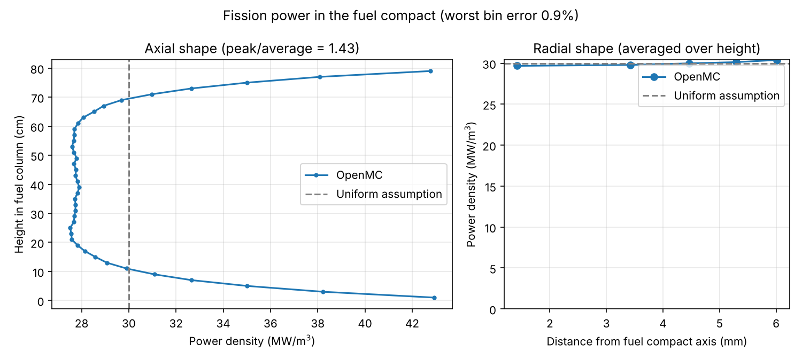

# Coupled OpenMC–MOOSE Multiphysics Simulation of HTGR Microreactor RVE
## Status: Active Development — Phase 3 (rebuilt for uniform vs. OpenMC comparison; awaiting first full run)

A 2-step coupled neutronics and thermo-mechanical finite element simulation of a transportable High-Temperature Gas-Cooled Reactor (HTGR) microreactor core unit cell based on Project Pele. The workflow couples Monte Carlo neutron transport (**OpenMC**) with continuum thermal-stress analysis (**MOOSE Framework**).

## Technical Overview

This repository models the coupled reactor physics, spatial heat generation, temperature distribution, and von Mises stress state in a TRISO fuel compact / H-451 graphite matrix Representative Volume Element (RVE). 

**Problem statement:** How much does a simplified physics assumption change the answer, and what does extra fidelity cost? The same MOOSE thermal-stress model is run twice with the *same total power*:

| Case | Heat source in the fuel compact | Input |
|---|---|---|
| **A — Simplified** | Uniform volumetric heating $Q = Q_{avg}$ | `moose/case_uniform.i` |
| **B — Higher fidelity** | Spatially varying $Q(x,y,z)$ from an OpenMC neutron transport solve | `moose/case_openmc.i` |

The cases are compared on peak temperature, peak von Mises stress, and compute time (including the OpenMC run needed for Case B).

* **Physics Modules:** Monte Carlo Neutron Transport, `HeatConduction`, `TensorMechanics`
* **Software Stack:** OpenMC, MOOSE Framework, Coreform Cubit, Python (`h5py`, `scipy`), ParaView
* **Target Materials:** HALEU TRISO compacts (19.75% U-235), H-451 Nuclear Graphite, Helium Coolant
* **Coupling Paradigm:** Off-line 2-step data transfer (Neutronics Mesh Tally $\rightarrow$ Spatial Heat Source Kernel)

## 4-Phase Development Workflow

### Phase 1: OpenMC Neutronics & Power Tallying [*COMPLETE*]
* Define isotopic compositions for HALEU TRISO compacts, H-451 graphite matrix, and helium channels.
* Build a Constructive Solid Geometry (CSG) model of the $18.80\text{ mm} \times 9.40\text{ mm}$ quarter-cell RVE in OpenMC, matching the CAD cross-section exactly (quarter coolant hole $r = 7.94$ mm at the origin corner, quarter fuel compact $r = 6.35$ mm at the opposite corner).
* Model a **full-height 80 cm fuel column** with 40 cm graphite reflectors above and below (vacuum at the top and bottom, reflective on the sides), so the axial power shape is physically meaningful.
* Model the fuel compact as homogenized TRISO particles (35% packing fraction) in a graphite binder.
* Execute Monte Carlo eigenvalue solve ($k_{\text{eff}}$) with a cylindrical mesh tally on the fuel compact to extract the fission power shape.

### Phase 2: CAD Geometry & Coreform Cubit Meshing [*COMPLETE*]
* Model the 3D unit cell in SolidWorks and export to `.STEP` format.
* Execute automated Coreform Cubit journal script (`create_mesh.jou`) to generate a swept HEX8 mesh with two blocks: `matrix_graphite` and `fuel_compact`.
* Define explicit surface sidesets (`symm_x_min`, `symm_y_min`, `bottom_face`, `fuel_wall`, `coolant_wall`) and scaling to SI units.

### Phase 3: Data Coupling & MOOSE Multiphysics Solve [*IN PROGRESS - VERIFICATION*]
* Run Python bridge script (`coupling/map_power.py`) to parse OpenMC `statepoint.*.h5` tally outputs, normalize to the target average power density, and write a 3D x-y-z grid for MOOSE.
* Shared MOOSE base input (`moose/pele_core_sim.i`) plus two case files that only swap the heat source: `ConstantFunction` (Case A) or `PiecewiseMultilinear` driven by OpenMC (Case B).
* Enforce planar symmetry roller constraints and solve coupled non-linear heat conduction and isotropic linear elasticity.
* Built-in energy balance check (`power_in` vs `power_out` postprocessors) and run-time reporting.

### Phase 4: Comparative Stress Analysis & Documentation [*PLANNED*]
* Compare thermal gradients and von Mises stress fields between realistic neutronics power profiles vs. uniform volumetric heat assumptions.
* Compare cost: OpenMC + mapping + MOOSE wall time (Case B) vs. MOOSE alone (Case A).
* Process Exodus II results in ParaView to identify peak stress concentrations along the fuel-graphite interface.
* Document structural safety margins and local peaking factors for microreactor core licensing considerations.

## Verification & Quality Assurance (QA)

To ensure numerical stability, physical conservation, and accurate multivariable coupling between OpenMC and MOOSE, this workflow executes specific verification checks across four modeling domains:

### 1. Spatial Geometry & Mesh Quality Checks (SolidWorks & Coreform Cubit)
* **Domain Bounding:** Verified unit cell dimensions ($18.80\text{ mm} \times 9.40\text{ mm}$) against Project Pele RVE design specs to prevent volume overlaps.
* **Element Metrics:** Inspected the HEX8 mesh in Coreform Cubit to enforce minimum scaled Jacobian values $> 0.6$ and aspect ratios $< 3.0$ across high-gradient fuel-matrix interfaces.
* **Unit Consistency:** Automated scale transformations in `create_mesh.jou` to convert CAD dimensions ($\text{mm}$) to SI units ($\text{m}$) required by MOOSE.
* **Sideset Integrity:** Validated explicit surface sideset IDs (`symm_x_min`, `symm_y_min`, `bottom_face`, `fuel_wall`, `coolant_wall`) against Exodus block exports to prevent unconstrained degrees of freedom.

### 2. Neutronics & Cross-Section Verification (OpenMC)
* **Isotopic Composition:** Verified HALEU enrichment ($19.75\text{\% } ^{235}\text{U}$) and H-451 graphite composition against nominal HTGR material specifications.
* **Eigenvalue Convergence:** Shannon entropy and per-batch $k$ are plotted by `neutronics/check_convergence.py` (`images/source_convergence.png`) to confirm the fission source has settled before the active batches begin.
* **Spatial Alignment:** OpenMC geometry uses the same corner origin and dimensions as the CAD / Cubit mesh (converted cm $\leftrightarrow$ m).
* **Tally Estimator Verification:** The cylindrical fuel-mesh tally uses the *collision* estimator. In OpenMC 0.16 the default tracklength estimator on this mesh (whose edges coincide with reflective boundaries) produced a spurious ~16% radial tilt and axial end bumps; collision results agree with an independent fine `RegularMesh` tally to within ~0.5%.

### 3. Data Transfer & Energy Conservation (Python Bridge)
* **Spatial Mapping:** Verified `map_power.py` grid interpolation routines using `h5py` and `SciPy` to eliminate energy leakage or spatial distortion during HDF5-to-CSV data transfer.
* **Integrated Heat Check:** Verified total integrated volumetric fission heat ($\iiint Q(x,y,z) \, dV$) calculated from OpenMC matches the integrated heat flux input assigned across MOOSE material blocks.

### 4. Continuum Mechanics & Boundary Constraints (MOOSE)
* **Rigid-Body Mode Elimination:** Applied planar symmetry roller constraints (`symm_x_min`, `symm_y_min`, `bottom_face`) to eliminate 6 rigid-body modes without inducing artificial thermal stresses.
* **Material Property Mapping:** Cross-referenced temperature-dependent thermal conductivity, coefficient of thermal expansion (CTE), and Young's modulus across graphite and fuel blocks against nuclear materials handbook baselines.

## Project Structure

```text
.
├── cad/                  # SolidWorks .STEP geometry files
├── coupling/             # Python scripts to map OpenMC HDF5 tallies to MOOSE functions
├── images/               # High-res renders and comparison plots
├── meshes/               # Coreform Cubit .jou scripts and exported Exodus (.e) meshes
├── moose/                # MOOSE input files (.i) and material definitions
├── neutronics/           # OpenMC Python model, cross-section links, and tally definitions
├── post-processing/      # ParaView state files (.pvsm) and CSV line plots
└── README.md
```

## Preliminary Neutronics Results

From the full-height OpenMC model (ENDF/B-VII.1 data, 20,000 particles × 150 active batches):

* $k_{\text{eff}} = 1.218 \pm 0.0005$ (fresh fuel, no control rods or burnable poisons, ~20% axial leakage).
* **Axial power peaking factor ≈ 1.43**, at the *ends* of the fuel column, not the middle. Fast flux peaks mid-column, but thermal neutrons build up in the pure-graphite reflectors and flow back into the fuel ends (*reflector peaking*). The middle of the column runs ~8% *below* the average.
* Radial variation across the compact is only ~1–2%: the homogenized TRISO compact is optically thin.
* Implication for the comparison: the uniform-heat assumption under-predicts local power at the column ends by ~40%.



## How to Run

All commands are run from the repository root in WSL unless noted.

1. **Run OpenMC Neutronics Solve:**
   ```bash
   python neutronics/openmc_rve_model.py
   ```
   *Outputs `neutronics/statepoint.250.h5` containing $k_{\text{eff}}$ and the fuel power tally (about 5–10 minutes on 4 cores).*

   Check that the fission source converged:
   ```bash
   python neutronics/check_convergence.py
   ```

2. **Map OpenMC Power Density to MOOSE Grid:**
   ```bash
   python coupling/map_power.py --plot
   ```
   *Writes `moose/openmc_power.txt` and `images/power_profile.png`. Use `--q-avg` to change the average fuel power density (default `3.0e7` W/m³). If you change it, change `value` in `moose/case_uniform.i` to match.*

3. **Generate Exodus FEA Mesh (re-run whenever the journal changes):**
   ```bash
   cd meshes && cubit -nographics create_mesh.jou && cd ..
   ```

4. **Execute both MOOSE cases** (from the `moose/` folder):
   ```bash
   cd moose
   mpiexec -n 4 combined-opt -i pele_core_sim.i case_uniform.i
   mpiexec -n 4 combined-opt -i pele_core_sim.i case_openmc.i
   ```
   *Outputs `pele_uniform_out.e/.csv` and `pele_openmc_out.e/.csv`. Check that `power_in` ≈ `power_out` in each CSV.*

5. **Visualize Results:**
   Open `moose/pele_uniform_out.e` and `moose/pele_openmc_out.e` in ParaView side by side.
