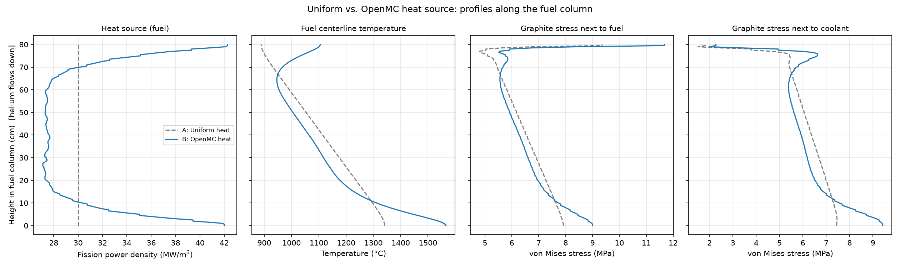

# Case comparison: uniform vs. OpenMC heat source

Generated by `post-processing/compare_cases.py`.

| Quantity | Case A: Uniform | Case B: OpenMC | Difference (B − A) |
|---|---|---|---|
| Peak fuel temperature | 1341 °C | 1566 °C | 225 °C |
| Height of peak fuel temperature | 0 cm | 0 cm | 0 cm |
| Peak graphite temperature | 1332 °C | 1554 °C | 222 °C |
| Peak von Mises stress, fuel | 18.3 MPa | 22.0 MPa | 3.7 MPa (+20%) |
| Peak von Mises stress, graphite | 11.5 MPa | 14.8 MPa | 3.3 MPa (+29%) |
| Total heat generated | 758.8 W | 758.8 W | -0.0 W (-0%) |
| Energy balance error (out vs. in) | -4.33 % | -4.34 % | -0.00 % |
| MOOSE run time | 222.1 s | 78.2 s | -143.9 s (-65%) |
| OpenMC run time (needed for Case B only) | 0 s | 547 s | 547 s |
| Total compute time | 222 s | 625 s | 403 s (+181%) |

