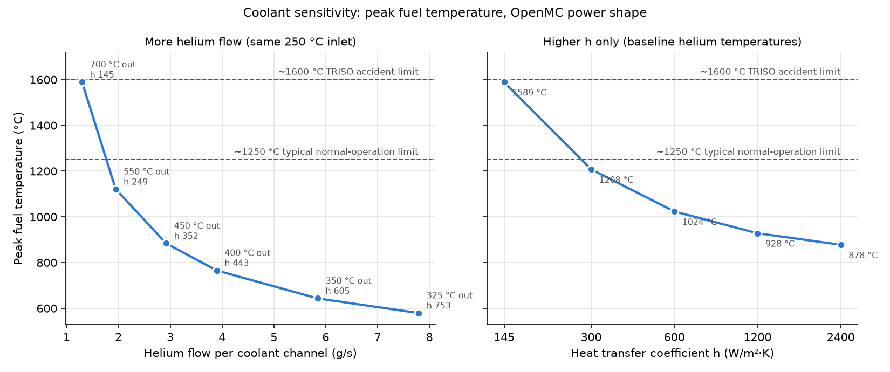

# Coolant sensitivity sweep (OpenMC power shape)

Generated by `post-processing/coolant_sweep.py`. Same power and mesh in every run; helium inlet fixed at 250 °C, flowing down. Flow-sweep h comes from the same correlation as `coupling/map_power.py`.

| Run | He flow per channel | He outlet | h | Peak fuel T | Peak graphite T | Peak von Mises fuel / graphite | Energy balance |
|---|---|---|---|---|---|---|---|
| Flow ×1 | 1.30 g/s | 700 °C | 145 W/m²·K | 1589 °C | 1577 °C | 22.3 / 15.1 MPa | +0.00 % |
| Flow ×1.5 | 1.95 g/s | 550 °C | 249 W/m²·K | 1121 °C | 1107 °C | 16.1 / 11.3 MPa | +0.00 % |
| Flow ×2.25 | 2.92 g/s | 450 °C | 352 W/m²·K | 884 °C | 869 °C | 12.9 / 9.6 MPa | +0.00 % |
| Flow ×3 | 3.90 g/s | 400 °C | 443 W/m²·K | 765 °C | 750 °C | 11.4 / 8.8 MPa | -0.00 % |
| Flow ×4.5 | 5.84 g/s | 350 °C | 605 W/m²·K | 643 °C | 627 °C | 9.8 / 7.9 MPa | +0.00 % |
| Flow ×6 | 7.79 g/s | 325 °C | 753 W/m²·K | 579 °C | 563 °C | 8.9 / 7.4 MPa | +0.00 % |
| h only = 300 | 1.30 g/s | 700 °C | 300 W/m²·K | 1208 °C | 1194 °C | 17.2 / 10.7 MPa | -0.00 % |
| h only = 600 | 1.30 g/s | 700 °C | 600 W/m²·K | 1024 °C | 1009 °C | 14.8 / 9.1 MPa | +0.00 % |
| h only = 1200 | 1.30 g/s | 700 °C | 1200 W/m²·K | 928 °C | 913 °C | 13.4 / 8.0 MPa | +0.00 % |
| h only = 2400 | 1.30 g/s | 700 °C | 2400 W/m²·K | 878 °C | 863 °C | 12.7 / 7.2 MPa | +0.00 % |

- Peak fuel is already below 1600 °C at the baseline flow (1589 °C), with only 11 K margin.
- Peak fuel drops below 1250 °C at about 1.8 g/s per channel (1.4× baseline flow) in the flow sweep, and at about h ≈ 283 W/m²·K with the baseline helium temperatures.

TRISO limits are commonly quoted reference values, for orientation only.

